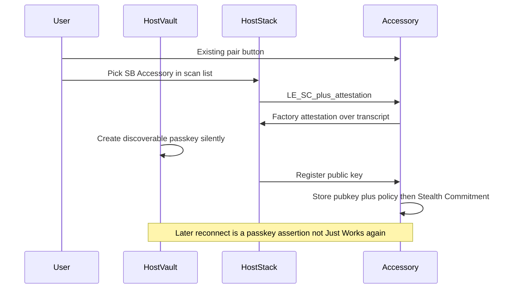

# Rewrite Bond Passkey as a real (invisible) passkey

You are right that the current spec is the wrong credential. Today a Bond Passkey is a labeled Long Term Key from Just Works ([`docs/spec/stealth-bonding.md`](docs/spec/stealth-bonding.md) §5). That is not how web passkeys work, and it is not “pairing authenticated by a cryptographic secret” beyond what Bluetooth already does.

## What you want (locked)

- Same *function* as a web passkey: asymmetric credential, private key never leaves the authenticator, named, revocable.
- User never sees a secret, QR, or number.
- Gestures: only the pairing controls the product already has (button on the Accessory, pair in the Host operating-system list).
- Best practice / least hassle: **Host is the authenticator** (phone or laptop platform vault, same place as iCloud / Google / Windows passkeys). **Accessory is the relying party** (stores public keys, like a website).

That is the web mapping. It is also the better UX: a second device on the same account can use a synced passkey; a friend’s phone is a new enrollment; revoke lives in the Host’s existing passkey settings.

## Phone UX (locked): no “click passkey”

The user does **not** get a WebAuthn sheet, account picker, “Use passkey?” button, QR, number compare, or biometric-for-this-passkey prompt.

Pairing is only:

1. Hold the Accessory’s existing pair button (Enrollment Window).
2. On the phone: Settings → Bluetooth → tap **SB Accessory** (or the operating system’s normal pair row). Same tap as pairing any speaker today.

The operating system creates and later asserts the credential **inside the Bluetooth stack**, silently. Unlocking the phone to open Settings is normal phone use, not a passkey click.

Reconnect: the phone and speaker find each other the way they already do. No extra tap, no passkey dialog.

Where the passkey *may* appear later (optional, not during pair): the operating system’s saved-passkeys / forgotten-devices list, if the user goes looking to revoke. That is Settings bookkeeping, not a ceremony.

If a platform passkey API cannot create a credential without showing a chooser, that platform is **non-conformant** for this mode until it grows a silent Bluetooth-pairing ceremony. We do not paper over that by putting a website-style prompt in the pair flow.

## The hard limit (do not paper over)

You cannot get **instance-level** man-in-the-middle safety (this exact speaker in your hand vs an attacker’s radio) if the user confirms nothing unique to this session and there is no physical out-of-band channel (NFC tap, printed code). Web passkeys are safer than passwords because the user sees the site and the authenticator checks origin. If we hide all of that, we throw away that part.

**Best-practice substitute that stays invisible:** a **factory attestation key** on the Accessory (same idea as Fast Pair’s anti-spoofing key). The Host verifies “this is a genuine device of this model” and binds the new passkey to that attestation plus the pairing transcript. The user still only hits pair. An attacker without the factory key cannot complete registration. A cloned speaker of the same model with a stolen factory key still can — that is the residual, and the spec must say so.

Just Works remains forbidden as the *trust root* for a Bond Passkey. Low Energy Secure Connections stays as the **link cipher** (encrypt the radio). The **authenticator** of the pair is the passkey + attestation, not Just Works.

## Factory attestation plus rotating proofs (not Authy)

The instinct is right: a factory key **plus** something that changes so the other device can recognize a *this-moment* proof, not a replayed one. The Authy mechanism is the wrong one.

**Authy / TOTP** is a shared symmetric seed both sides already have. They compute `HMAC(seed, time)` and compare a short code. That works for “I am logging into a website I already trust.” It is a bad Bluetooth pairing recognizer:

- The seed has to get onto the phone somehow. If it is in the factory image, one leak clones the product line. If a manufacturer cloud hands it out, we have rebuilt Fast Pair’s account-key service.
- A 6-digit code is ~20 bits. Fine when a human types it into a rate-limited site. Useless as the only check on a radio.
- If both sides compare the code *on the same radio you are trying to authenticate*, a man-in-the-middle just relays it. Time-rotation does not bind the pairing transcript.
- It needs clocks. It is not a passkey (no vault, no sync, no revoke-as-a-credential).
- The user would either see digits (forbidden) or we would compare silently (then it is just a weak shared secret).

**What we use instead** (same user-visible nothing, actually cryptographic):

| Piece | Rotates? | Job |
| --- | --- | --- |
| Factory attestation key | **No.** Stable, burned in at manufacture | “This Accessory is a genuine device of this model.” Signs the pairing transcript. |
| Pairing / reconnect **challenge** (nonce) | **Yes, every time** | Fresh bytes from the peer. The signer proves they hold the key *now*, over *this* session. Replay fails. |
| Bond Passkey (Host vault key pair) | **No** as a root (like a web passkey). Each **assertion** signs a new challenge | After enrollment, the phone is recognized because it can sign. That is the “other device recognizes you” part. |
| Resolvable Private Address (Low Energy Privacy) | **Yes, on a timer** | The *radio address* rotates so scanners cannot track a stable MAC. Recognition is via the Identity Resolving Key, not a TOTP code. |

So: factory key authenticates the Accessory at first pair; a rotating **nonce + signature** is what the other device recognizes; the Bond Passkey is a stable vault credential whose *proofs* rotate; the Bluetooth address rotates for privacy. No shared TOTP seed, no digits, no Authy-shaped protocol.

Freshness MUST be a random challenge (or monotonic counter) included in the signed bytes, not `HMAC(seed, unix_time)`.

## Credential model (replaces §5)

A Bond Passkey SHALL be a discoverable public-key credential, not an Long Term Key with a nickname.

| Held by | What |
| --- | --- |
| Host platform vault | Private key, credential id, relying-party id for this Accessory, friendly name the OS may show in the passkey list (user is not shown a secret at pair time) |
| Accessory Bond Table | Credential id, public key, stealth policy, reconnect mode, revoked flag |

- Algorithm: same class as platform passkeys (e.g. ES256 / P-256). Do not invent a new curve.
- Reconnect / proof of possession: Accessory sends a fresh challenge, Host asserts (sign the challenge with the vault key). Then encrypt the link with the existing Low Energy Secure Connections Long Term Key **or** a link key derived from the authenticated session — pick one in the spec and keep it boring (recommend: keep LE SC for encryption; passkey assertion is what authorizes “this Host may have a bond”).
- First-pair freshness: Accessory attestation signature MUST cover the pairing transcript plus a Host nonce so a recorded attestation cannot be replayed.
- Address rotation stays Low Energy Privacy (resolvable private addresses), not a one-time-password.
- Synced Hosts that share a vault: same credential id, no second Enrollment Window.
- A Host that does not have that credential: Enrollment Window (pair button) or Delegated Enrollment from a Host that already holds a live assertion.

Stealth Commitment, Public Advertising, Directed Knock, Enrollment Window timing stay. Those were never the wrong part.

## What we will not do

- Use Authy / TOTP / short rotating digits as the recognizer (shared seed, time-step HMAC). Freshness is a challenge-response signature, not a one-time password.
- Show a “use passkey?” / account-picker / biometric-for-passkey sheet during pair or reconnect.
- Require Numeric Comparison, typed Bluetooth Passkey Entry, QR, or NFC for the default path.
- Put the private key on the Accessory (security-key inversion; no vault sync; worse UX).
- Replace the Bluetooth host stack with a WebAuthn browser API. This is still a Core pairing-mode extension; the Host operating system’s passkey provider is the authenticator backend.
- Claim first-pair is safer than Just Works without attestation. If a stack cannot verify attestation, it MUST refuse Stealth Bonding (or fall back to ordinary pairing, which is not a Bond Passkey).

## Doc and oracle changes (this repo)

Rewrite in place; do not start a second protocol name.

- [`CONTEXT.md`](CONTEXT.md) — Bond Passkey = Host-held discoverable public-key credential; Accessory stores the public key. Avoid “labeled LTK.”
- [`docs/spec/stealth-bonding.md`](docs/spec/stealth-bonding.md) — §5 credential fields; §9 add attestation + registration + assertion; §13 keep pair-button UX; §16 rewrite: Just Works is not the trust root; attestation residual; vault sync.
- New ADR `docs/adr/0006-host-vault-passkey.md`: Host vault, Accessory public keys, attestation for first pair, LE SC still the link.
- Amend [`docs/adr/0002-reuse-le-secure-connections.md`](docs/adr/0002-reuse-le-secure-connections.md): still no home-grown *link* math; the Bond Passkey is now a real passkey, not “LE SC is the whole credential.”
- [`docs/primer.md`](docs/primer.md), [`.scratch/stealth-bonding/spec.md`](.scratch/stealth-bonding/spec.md), [`docs/adoption-path.md`](docs/adoption-path.md) — the earlier “Bond Passkey does no crypto work” line becomes false; first-pair safety is attestation-bound, not Just Works.
- Simulator [`sim/`](sim/): Bond Passkey becomes a key-pair fixture (sign/verify), not a counter plus LTK nickname. Add tests: registration without valid attestation fails; assertion reconnect succeeds; synced-credential second Host does not need a new Enrollment Window; stranger Host does. Keep stealth / public-scan tests.

Firmware on the Development Kit **cannot** implement the Host vault. After the spec rewrite, the nRF app stays the Generic Access Profile hide demo until a Linux or test Host can assert. Do not pretend the current firmware is spec-complete.

## How we test (what is actually possible)

There is no iPhone silent-vault to point at. We test the protocol in layers. Each layer proves something the one below cannot.

| Layer | What it is | What it proves | What it does not prove |
| --- | --- | --- | --- |
| **0. Simulator** (this repo, first) | In-process Host + Accessory. Real P-256 sign/verify fixtures for factory key and vault key. Same seam: `pair` / `reconnect` / advertising + Bond Table. | Attestation over transcript+nonce required; replayed nonce fails; assertion reconnect succeeds; synced Host (same credential id) skips Enrollment Window; stranger Host cannot; stealth scan-list tests still pass. | Radio, clocks, a real operating-system vault, manufacturing. |
| **1. Two-role test Host** (next, still no phone OS) | A small Linux or Rust program that is a Host: file-backed vault (one key pair on disk), talks to a second process or to a board. Not iCloud, not WebAuthn UI. | On-air or socket PDUs: Accessory rejects bad attestation; Host assertion is checked; no passkey sheet appears because there is no sheet. | Apple / Google / Microsoft silent ceremony. |
| **2. Development Kit hide** ([`docs/nrf52840-dk-setup.md`](docs/nrf52840-dk-setup.md)) | Current Zephyr app + a normal laptop. | Scan list empties after ordinary pair. Filmable. | The Bond Passkey. The laptop will Just Works. Label the video “Generic Access Profile hide only.” |
| **3. Development Kit + test Host** | nRF Accessory with a **test** factory key in firmware; Linux test Host with a file vault. Optional second kit as central. | First on-air attestation + assertion. This is the first time “the passkey function” is on a radio. | Platform vault sync, App Store phones. |
| **4. BlueZ** | Patch or userspace plugin once PDUs are stable. | A real Host stack, still not a consumer phone. | Silent iCloud/Google vault. |
| **5. Phone OS** | Only when a vendor implements the silent Bluetooth-pairing ceremony. | The product you imagined. | — |

**Do not** try to test the vault by pairing the kit from Windows/iPhone Settings and calling that a passkey test. That only tests hide.

**Do not** need Authy, a second phone’s authenticator app, or a website WebAuthn dialog. Those would test the wrong protocol.

Conformance tests to add in `sim/tests/conformance.rs` (red first):

- `registration_fails_without_attestation`
- `registration_fails_on_replayed_attestation_nonce`
- `assertion_reconnect_succeeds`
- `replayed_assertion_challenge_fails`
- `synced_host_same_cred_skips_enrollment`
- `stranger_host_needs_enrollment`
- existing stealth / public-scan / commitment-fail tests stay

## Adoption path changes (yes — rewrite [`docs/adoption-path.md`](docs/adoption-path.md))

The old path optimized for a filmable hide, then BlueZ, then a room OEM. That still matters for **Stealth Commitment**. It does **not** prove or ship the new Bond Passkey.

What changed:

- The Bond Passkey now **does** cryptographic work (attestation + vault assertion). The old “mostly bookkeeping” line is false.
- The blocking customer is no longer “an OEM who will hide.” It is **a Host that can create a silent vault credential**. Nordic/Zephyr cannot give you that. Apple/Google/Microsoft (or BlueZ + a file vault) can.
- The Development Kit demo **drops in importance for the passkey** and **stays Phase A for the hide**. Two videos, two claims. Do not mix them.
- A **test Host** (file-backed vault) must exist before we talk to OEMs about the passkey. Otherwise we are selling hide-after-pair again.
- Google is harder, not easier: Fast Pair plus a silent platform passkey is two sacred cows.
- Shared-room OEMs still buy the hide. Information technology / revoke / “second laptop just works” is the passkey pitch, and it only works after a Host vault exists.

Revised order:

| Phase | Work | Proves | Stop if |
| --- | --- | --- | --- |
| **A** | Simulator oracle (attestation, assertion, sync vs stranger, stealth). | The credential is real on paper. | Tests cannot be written without cheating (stubbed “always ok”). |
| **B** | nRF hide demo (existing firmware). Film scan list. | People still understand the hide. | Hide fails on a real scan list. |
| **C** | File-vault test Host + Accessory (process or kit). | Passkey function on a link we control. | Assertion cannot be checked without a phone OS. |
| **D** | BlueZ or userspace Host with that vault. | First shippable Host shape. | Maintainers refuse unknown opcodes / vault hook. |
| **E** | Zephyr Accessory sample: test factory key, verify assertions, then hide. | OEMs can copy the Accessory side. | — |
| **F** | One room OEM for the hide; talk passkey only if they have a Linux/test Host story. | A customer. | They only wanted hide. |
| **G** | SIG after D+E+F. Then Android/Windows silent ceremony. Apple last. | The 1.5–2B Hosts. | We went to SIG with only a hide demo. |

**This month (after spec rewrite):** Phase A simulator, not a phone. Buy the kit when you want the hide video (B), not because it will show a passkey.

Company order, updated: (1) this repo’s simulator and test Host, (2) Zephyr Accessory, (3) BlueZ / Linux, (4) Nordic sample + factory-key story, (5) room OEM for hide, (6) Google/Microsoft for silent vault, (7) Apple last.

## Suggested implementation order after you accept this plan

1. Glossary + ADR 0006 + spec §5/§9/§16.
2. Rewrite [`docs/adoption-path.md`](docs/adoption-path.md), primer, scratch build-spec, and a short testing ladder in [`docs/reference-implementation.md`](docs/reference-implementation.md).
3. Simulator tests first (red), then model (green).
4. Leave Zephyr vault work and `0xF0`/`0xF1` until those PDUs are stable. Hide firmware stays as-is.
