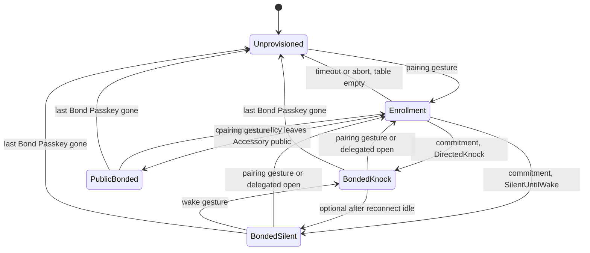
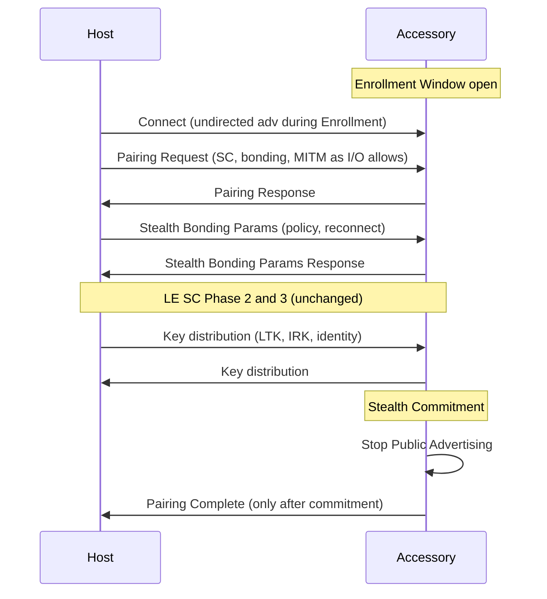

# Stealth Bonding Protocol Specification

| Field | Value |
| --- | --- |
| Version | 0.1.0-draft |
| Status | Individual draft. Not a Bluetooth SIG adopted specification. |
| Project | IoT Passkey |
| Date | 2026-08-16 |
| Intended venue | Bluetooth Core Specification extension (SMP + GAP), with an optional GATT management service |
| License | Creative Commons Attribution 4.0 International (CC BY 4.0) |

This document is the normative specification. Domain terms match `CONTEXT.md`. Architectural decisions that this draft locks in are recorded in `docs/adr/`.

---

## Abstract

Stealth Bonding is a Bluetooth pairing mode. Two devices that both support it perform LE Secure Connections bonding, store a per-peer **Bond Passkey**, and then apply a **Stealth Commitment**: the Accessory (and, if negotiated, the Host) leaves **Public Advertising**. A normal operating-system scan list SHALL NOT show the Accessory as a named or anonymous device.

The mode is designed for screenless Accessories that already have a pairing button and an LED. It does not require new hardware. A device may hold multiple Bond Passkeys. Additional peers are enrolled through the same pairing gesture or through **Delegated Enrollment** from an already-bonded Host.

Stealth Bonding is a protocol-level feature. It cannot be installed as an application on an arbitrary Bluetooth device.

---

## 1. Introduction

### 1.1 Motivation

Bluetooth pairing and discoverability are already protocol concerns (Link Layer, Security Manager, GAP). After a typical speaker is paired, many products hide themselves as a vendor policy. That behavior is not interoperable, not mandatory, and not bound to a named, revocable credential.

LE Privacy still transmits undirected advertisements. Those packets often appear as a nameless device in a scan list. WebAuthn/FIDO passkeys are a credential model for authenticators, not a Bluetooth pairing mode for speakers. Google Fast Pair and FIDO-over-BLE are related prior art; neither is a Core Spec pairing mode that forbids Public Advertising after bond.

The gap is a standardized pairing mode that:

1. Creates a distinct Bond Passkey per peer.
2. Forces the Accessory out of Public Advertising when pairing succeeds.
3. Still allows bonded Hosts to reconnect.
4. Works on devices that will not be redesigned.

### 1.2 Goals

- Interoperable pairing across Hosts and Accessories that implement this specification.
- Default one-way stealth: Accessory hidden, Host still shown.
- Optional two-way or no-stealth policies, negotiated per bond.
- Multiple Bond Passkeys on one Accessory.
- Existing pairing-button UX. No new buttons, screens, or LEDs.
- Fallback to existing Bluetooth pairing when the peer does not support this mode.
- Open specification suitable for chip, firmware, and OS implementation.

### 1.3 Non-goals

- A downloadable app, APK, IPA, or driver that enables this on any existing radio.
- A GATT-only profile that tries to own advertising and bonding.
- New pairing mathematics. LE Secure Connections is reused.
- Radio invisibility against a sniffer. Physics is out of scope.
- Replacing WebAuthn, FIDO CTAP, or platform authenticators.
- Requiring a companion application for first pairing.
- Patent claims. This draft is published so the procedure can be implemented.

### 1.4 Relationship to existing Bluetooth features

| Feature | What it already does | What Stealth Bonding adds |
| --- | --- | --- |
| LE Secure Connections | P-256 ECDH, LTK | Required as the only pairing method in this mode |
| LE Privacy / IRK / RPA | Bonded peers can resolve rotating addresses | Not sufficient: undirected ads may still blip |
| GAP Limited Discoverable | Time-bounded discovery | Used only for the Enrollment Window |
| Bonding / bond table | Stores keys per peer | Bond Passkey adds policy, reconnect mode, and revocation identity |
| Filter Accept List | Controller ignores unknown initiators | Allowed as an aid, not a substitute for leaving Public Advertising |
| Bluetooth Passkey Entry | Six-digit association model | Unrelated. Do not confuse with Bond Passkey |
| Fast Pair / FIDO BLE | Vendor or authenticator profiles | Out of band to this Core pairing mode |

---

## 2. Conventions

The key words **MUST**, **MUST NOT**, **REQUIRED**, **SHALL**, **SHALL NOT**, **SHOULD**, **SHOULD NOT**, **RECOMMENDED**, **MAY**, and **OPTIONAL** in this document are to be interpreted as described in [RFC 2119](https://www.rfc-editor.org/rfc/rfc2119) and [RFC 8174](https://www.rfc-editor.org/rfc/rfc8174) when, and only when, they appear in all capitals.

Normative text uses those keywords. Examples, appendices marked informative, and notes are non-normative.

This specification refers to the Bluetooth Core Specification, Host volume:

- GAP — Generic Access Profile, [Vol 3] Part C
- SMP — Security Manager Protocol, [Vol 3] Part H
- GATT — Generic Attribute Profile, [Vol 3] Part G

and to the Low Energy Controller volume:

- Link Layer advertising PDUs, [Vol 6] Part B

---

## 3. Terminology

Terms in **bold** are defined in `CONTEXT.md` and are used with those meanings here.

Additional terms used only in this specification:

**Peer.** The other device in a pairing or reconnection attempt.

**Unprovisioned.** An Accessory whose Bond Table is empty.

**Public scan list.** The list of devices an ordinary Host OS shows during Bluetooth discovery (Settings → Bluetooth, and equivalents).

**Controller.** The Bluetooth controller, including the Link Layer.

**Host stack.** The Bluetooth host implementation on either device (not the Stealth Bonding Host role).

---

## 4. Architecture

### 4.1 Layering

Stealth Bonding is a pairing-mode extension. It SHALL be implemented in the host Security Manager and GAP, with Controller support for the advertising states in Section 7.

```
┌─────────────────────────────────────────────┐
│  Host OS UI / Accessory pairing button      │  existing UX
├─────────────────────────────────────────────┤
│  Stealth Bonding Management Service (GATT)  │  OPTIONAL, post-bond only
├─────────────────────────────────────────────┤
│  GAP  — discoverability, advertising policy │  REQUIRED
│  SMP  — pairing, Bond Passkey, commitment   │  REQUIRED
├─────────────────────────────────────────────┤
│  L2CAP / HCI                                │
├─────────────────────────────────────────────┤
│  Link Layer — Public Advertising off;       │  REQUIRED
│               Directed Knock / silent       │
└─────────────────────────────────────────────┘
```

A GATT service SHALL NOT be used to perform pairing or to apply Stealth Commitment. Those steps happen in SMP and GAP. GATT is permitted only as a management plane after a Bond Passkey exists (Section 15).

User-space applications on a Host MAY present UI. They MUST NOT be the sole implementation of advertising control or key storage.

### 4.2 Roles

During a given procedure a device takes one of these roles:

| Role | Typical product | Typical LE role |
| --- | --- | --- |
| **Accessory** | Speaker, earbuds, keyboard, sensor | Peripheral |
| **Host** | Phone, laptop, tablet | Central |

A device MAY implement both roles (a laptop pairing with another laptop). Requirements that say “Accessory” apply to the device that will leave Public Advertising under PeripheralOnly, which is the default.

### 4.3 No hardware redesign

An Accessory that already supports:

- LE Secure Connections,
- Limited Discoverable Mode,
- a pairing gesture (button hold, power-on window, or equivalent),
- and storage for at least two bonds,

SHALL be able to implement this specification in firmware without new buttons, screens, or indicators.

The Host is the display. Confirmations, names, Stealth Policy choices, and revocation live on the Host.

---

## 5. Bond Passkeys

### 5.1 Definition

A **Bond Passkey** is the credential that represents one successful Stealth Bonding with one peer. It is not a value the user types.

A Bond Passkey SHALL contain at least:

| Field | Type | Notes |
| --- | --- | --- |
| `bond_passkey_id` | 16 octets | Random, unique on the device that created it |
| `peer_identity_address` | 6 octets + type | From SMP identity distribution |
| `ltk` | 16 octets | From LE Secure Connections |
| `irk` | 16 octets | From identity distribution, if present |
| `stealth_policy` | 1 octet | Section 6 |
| `reconnect_mode` | 1 octet | Section 7.2 |
| `created_counter` | 4 octets | Monotonic on the local device |
| `revoked` | boolean | Set on revocation; keys SHALL be erased |

A Host MAY additionally store a UTF-8 friendly name for UI. An Accessory MUST NOT require a screen to store or use a Bond Passkey.

### 5.2 Bond Table

Each device that supports Stealth Bonding SHALL maintain a **Bond Table**.

- An Accessory MUST support at least 2 Bond Passkeys.
- An Accessory SHOULD support at least 8.
- If the table is full, a new Enrollment Window MUST fail until the user revokes an entry or performs factory reset. The Accessory MUST NOT silently evict a Bond Passkey.

Each Bond Passkey is independent. Revoking one MUST NOT revoke the others.

### 5.3 Lifetime

A Bond Passkey is created only after Stealth Commitment succeeds (Section 9.6).

A Bond Passkey ends when:

- it is revoked by the local user or by a management command from that same peer, or
- the device is factory-reset, or
- pairing is aborted after keys were tentatively stored (those keys SHALL be discarded and no Bond Passkey SHALL remain).

---

## 6. Stealth Policy

Stealth Policy is negotiated during pairing and stored on the Bond Passkey. Each device applies the policy to **its own** advertising. A peer MUST NOT remotely force a device to remain hidden if the device’s owner later sets that device discoverable by a local user action.

| Value | Code | Accessory after commitment | Host after commitment | Default use |
| --- | --- | --- | --- | --- |
| PeripheralOnly | `0x00` | No Public Advertising | Unchanged | Default. Speaker hidden, laptop shown |
| CentralOnly | `0x01` | Unchanged | No Public Advertising | Rare |
| Both | `0x02` | No Public Advertising | No Public Advertising | Shared or public Host |
| Neither | `0x03` | Unchanged | Unchanged | Setup / multi-device bench |

The initiator (normally the Host) proposes a policy. The responder MAY accept or reject. If the responder rejects, pairing of this mode SHALL fail. The devices MAY fall back to non-Stealth Bonding pairing (Section 14).

A Host that proposes `Both` or `CentralOnly` SHOULD warn that other peripherals may be harder to pair until the Host is made discoverable again.

If the pairing messages omit a policy, both sides SHALL use `PeripheralOnly`.

---

## 7. Advertising and discoverability state machine

### 7.1 States

An Accessory that supports Stealth Bonding SHALL implement the following GAP/Link Layer states. Names in this section are local to this specification.



| State | Public Advertising | Connectable | Purpose |
| --- | --- | --- | --- |
| `Unprovisioned` | YES (Limited or General) | YES | Factory / empty Bond Table |
| `Enrollment` | YES, Limited Discoverable only | YES | Add a Bond Passkey |
| `BondedKnock` | NO | Directed Knock only | Hidden; bonded Hosts can connect |
| `BondedSilent` | NO | NO until wake | Hidden; user or timer must wake |
| `PublicBonded` | YES | YES | Only when policy leaves Accessory public |

### 7.2 Reconnect modes

Stored on the Bond Passkey and applied when the Accessory is not in `Enrollment` or `Unprovisioned`.

| Mode | Code | Behavior |
| --- | --- | --- |
| DirectedKnock | `0x00` | Default. Accessory transmits connectable **directed** advertising to bonded identities. |
| SilentUntilWake | `0x01` | No advertising until an existing user gesture (power, play, pairing button). Then Directed Knock for `T_SB_KNOCK`. |
| FilterAcceptList | `0x02` | Connectable advertising MAY be used only if it is not Public Advertising as defined below. Unknown initiators SHALL be ignored. |

If omitted, both sides SHALL use `DirectedKnock`.

### 7.3 Public Advertising (normative definition)

**Public Advertising** is any of the following:

1. Undirected connectable or scannable advertising (`ADV_IND`, `ADV_SCAN_IND`, or equivalent extended undirected events) that a general or limited scanner can report to a public scan list.
2. Undirected advertising that includes a Local Name, Appearance used for general discovery, or Service UUIDs intended for general discovery.
3. BR/EDR inquiry scan in a discoverable mode (Limited or General).
4. Any advertising that uses a public or static device address while the device has distributed an IRK and is not in `Enrollment` or `Unprovisioned`.

The following are **not** Public Advertising:

- Connectable directed advertising (`ADV_DIRECT_IND` or equivalent extended directed events) targeted at a bonded identity.
- No advertising at all (`BondedSilent`).
- Encrypted connected traffic after a link is up.

A nameless undirected advertisement **is** Public Advertising. LE Privacy alone does not satisfy Stealth Commitment.

### 7.4 Directed Knock rules

When in `BondedKnock` the Accessory:

1. MUST NOT perform Public Advertising.
2. MUST use connectable directed advertising addressed to a bonded peer identity, or an equivalent Controller feature that is not reportable on a public scan list.
3. MUST NOT include Local Name or general-discovery Service UUIDs (directed legacy PDUs have no AD payload; extended directed events SHALL omit those fields).
4. SHOULD rotate among bonded identities if more than one Bond Passkey exists.
5. SHOULD use resolvable private addresses when an IRK was distributed.
6. MAY duty-cycle advertising to save power.

A Host reconnects by initiating to the stored identity. The Accessory MUST accept a connection from a peer that holds a non-revoked Bond Passkey.

### 7.5 Host discoverability

When the stored Stealth Policy is `PeripheralOnly` or `Neither`, this specification places no new requirement on Host discoverability.

When the policy is `Both` or `CentralOnly`, the Host SHALL leave General Discoverable Mode and SHALL NOT perform Public Advertising for new pairing until a local user action re-enables it. Existing bonds on the Host MUST remain usable.

---

## 8. Feature discovery

A device that supports Stealth Bonding SHALL indicate support so a peer can select the mode.

Until Bluetooth SIG assigned numbers exist, implementations of this draft SHALL use:

- **AD type / Service Data** UUID: `SB_SERVICE_UUID` (Section 21)
- **SMP feature bit** in the Stealth Bonding Params PDU (Section 9.3)
- **LE Features** bit: unassigned; implementations MAY use a manufacturer-specific HCI feature flag locally

A Host that sees `SB_SERVICE_UUID` in Enrollment advertising SHOULD offer Stealth Bonding as the preferred pairing mode.

An Accessory in `BondedKnock` or `BondedSilent` MUST NOT include `SB_SERVICE_UUID` in any Public Advertising, because it MUST NOT perform Public Advertising.

---

## 9. Pairing procedure

Stealth Bonding is LE Secure Connections bonding plus parameter exchange and Stealth Commitment. It has four phases after an LE link exists.



### 9.1 Preconditions

Both devices MUST support LE Secure Connections.

The Accessory MUST be in `Unprovisioned` or `Enrollment`.

The Accessory MUST have a free Bond Table slot.

If any precondition fails, the Accessory SHALL reject Stealth Bonding. The Host MAY attempt ordinary pairing (Section 14).

### 9.2 Phase 1 — SMP pairing feature exchange

Devices SHALL exchange SMP Pairing Request / Pairing Response with:

- Secure Connections bit set
- Bonding flags set (this mode always bonds)
- MITM bit set if either side’s I/O capabilities can support an authenticated association model
- Maximum encryption key size 16

LE Legacy Pairing MUST NOT be used for Stealth Bonding. If either side would fall back to Legacy Pairing, Stealth Bonding SHALL be aborted.

I/O capability mapping is in Section 13. For a screenless Accessory, `NoInputNoOutput` is expected. Association MAY be Just Works. That first-enroll MITM residual is documented in Section 16; it is the same class of risk as today’s speakers.

### 9.3 Phase 1b — Stealth Bonding Params

After a successful pairing feature exchange that selected LE SC and bonding, and before Phase 2 public-key exchange, the initiator SHALL send `Stealth Bonding Params`. The responder SHALL reply with `Stealth Bonding Params Response`.

If either side does not send or accept these PDUs, Stealth Bonding SHALL be aborted. Ordinary pairing MAY proceed instead.

#### 9.3.1 `Stealth Bonding Params` (SMP command, draft opcode `0xF0`)

| Offset | Size | Field | Description |
| --- | --- | --- | --- |
| 0 | 1 | opcode | `0xF0` (draft; replace when assigned) |
| 1 | 1 | version | `0x01` for this document |
| 2 | 1 | stealth_policy | Section 6 |
| 3 | 1 | reconnect_mode | Section 7.2 |
| 4 | 1 | flags | Bit 0: `require_delegated_confirm` for later enrollments. Bit 1: `allow_peer_policy_change`. Bits 2–7: reserved, MUST be 0 |
| 5 | 1 | max_bonds | Sender’s Bond Table capacity (1–255) |
| 6 | 2 | reserved | MUST be 0 |

#### 9.3.2 `Stealth Bonding Params Response` (draft opcode `0xF1`)

Same layout. `stealth_policy` and `reconnect_mode` are the values the responder accepts. They MUST be equal to the initiator’s proposal or pairing of this mode SHALL fail.

`max_bonds` is the responder’s capacity. It is informational.

Reserved bits MUST be ignored on receipt and MUST be zero on send.

### 9.4 Phase 2 — LE Secure Connections

Devices SHALL perform LE Secure Connections Phase 2 as specified in the Core Spec (public key exchange, DHKey, authentication stage 1 and 2).

This specification does not change the cryptographic primitives.

### 9.5 Phase 3 — key distribution

Devices SHALL distribute at least:

- LTK (via the SC procedure)
- Identity Address
- IRK, if the device will use resolvable private addresses (RECOMMENDED for Accessories)

Keys are held tentatively until Stealth Commitment succeeds.

### 9.6 Phase 4 — Stealth Commitment

After Phase 3 succeeds, each device SHALL apply the negotiated Stealth Policy to its own radio.

For an Accessory when policy is `PeripheralOnly` or `Both`:

1. The Host stack SHALL command the Controller to leave Public Advertising.
2. The Accessory SHALL enter `BondedKnock` or `BondedSilent` according to `reconnect_mode`.
3. The Accessory SHALL persist the Bond Passkey only after the Controller confirms the new advertising state.
4. Only then MAY the Accessory signal pairing success to the user (LED pattern, and SMP/HCI completion to the Host).

If the Controller cannot leave Public Advertising, the Accessory SHALL:

- discard tentative keys,
- send pairing failure,
- remain in `Enrollment` or return to `Unprovisioned`,
- MUST NOT leave a Bond Passkey in the table.

A Host MUST NOT present “Connected / Paired” as a Stealth Bonding success until it has received pairing completion after commitment. If the Accessory drops the procedure, the Host SHALL delete tentative keys.

### 9.7 Abort

On any failure after tentative key storage, both sides SHALL erase those keys. Partial Bond Passkeys MUST NOT remain.

---

## 10. Enrollment

### 10.1 Enrollment Window

An **Enrollment Window** is Limited Discoverable Mode for at most `T_SB_ENROLL` (default 30 s, maximum 180 s, aligned with GAP limited-discoverable practice).

During the window the Accessory MAY use Public Advertising, including Local Name, so the Host can select it.

When the window ends with no new Bond Passkey:

- if the Bond Table is empty, return to `Unprovisioned`;
- otherwise return to `BondedKnock` or `BondedSilent`.

Only one Enrollment Window SHALL be open at a time.

### 10.2 First enrollment

An Unprovisioned Accessory SHOULD be in Limited Discoverable Mode after power-on or the pairing gesture, for one Enrollment Window.

Procedure: Section 9. The Host is the screen. The Accessory remains `NoInputNoOutput` if it has no keys or display.

### 10.3 Subsequent enrollment (local gesture)

To add another Bond Passkey, the user performs the **same pairing gesture the product already ships with** (typically hold the Bluetooth button until the LED blinks).

The Accessory SHALL open an Enrollment Window. After success, Stealth Commitment runs again. Other Bond Passkeys remain valid.

### 10.4 Delegated Enrollment

A Host that holds a non-revoked Bond Passkey MAY request that the Accessory open an Enrollment Window without a local gesture. This is how a second phone is added when the Accessory is across the room and the user does not want a new button.

1. Host connects via Directed Knock (or an existing connection).
2. Link MUST be encrypted with that Bond Passkey.
3. Host writes `Open Enrollment` (Section 15).
4. Accessory opens an Enrollment Window.
5. If `require_delegated_confirm` is set on the Accessory, the authorizing Host MUST confirm the new Bond Passkey before Stealth Commitment on the new pairing. If confirmation is not received within `T_SB_ENROLL`, the new pairing SHALL be aborted and keys discarded.

Delegated Enrollment MUST NOT work from an unbonded peer.

### 10.5 Full table

If no slot is free, the Accessory SHALL refuse new pairing and SHOULD indicate the existing error pattern (LED). The Host SHOULD show that a Bond Passkey must be revoked first.

---

## 11. Reconnection

After Stealth Bonding, a bonded Host reconnects without Public Advertising.

1. Host uses the stored identity / IRK to initiate.
2. Accessory, if in `BondedKnock`, is performing Directed Knock.
3. Accessory, if in `BondedSilent`, is not connectable until a wake gesture; then it enters `BondedKnock` for `T_SB_KNOCK`.
4. On connection, encryption SHALL be started with the stored LTK. If encryption fails, the Accessory SHALL disconnect and MUST NOT open Public Advertising.

The Accessory MUST accept reconnection from any non-revoked Bond Passkey, not only the most recent one.

---

## 12. Revocation, policy change, and reset

### 12.1 Revoke one Bond Passkey

The owner MAY revoke a Bond Passkey from:

- the Host OS UI (forget device), which SHOULD also notify the Accessory if connected, or
- the Management Service `Revoke` command, or
- Accessory factory reset (all entries).

On revoke, LTK, IRK, and `bond_passkey_id` SHALL be erased. The peer’s leftover keys become useless.

### 12.2 Policy change

A device MAY change **its own** discoverability by a local user action at any time. That local action is outside this pairing mode.

Changing the stored Stealth Policy on a Bond Passkey MUST be a local user action or, if `allow_peer_policy_change` was set, a management write from that peer over an encrypted link. The peer still cannot prevent a later local override.

### 12.3 Factory reset

The product’s existing reset gesture SHALL erase the entire Bond Table and return the Accessory to `Unprovisioned`. This specification MUST NOT require a new reset control.

---

## 13. I/O capabilities and screenless devices

Stealth Bonding MUST use the existing SMP I/O capability exchange.

| Accessory hardware | IO Cap | Association | User action |
| --- | --- | --- | --- |
| No keys, no display | NoInputNoOutput | Just Works | Hold pairing button; confirm on Host if the OS asks |
| Yes/No only | DisplayYesNo | Numeric comparison if Host can display | Confirm on Host; Accessory button if it has one |
| Keyboard, no display | KeyboardOnly | Passkey Entry (Bluetooth sense) if Host displays | Only if the product already has keys |

This specification MUST NOT require Passkey Entry, numeric comparison, QR codes, or biometrics on the Accessory.

The Host SHOULD show:

- the Accessory’s advertised name during Enrollment,
- the resulting Bond Passkey as a named bond (“Kitchen speaker → Jacob’s laptop”),
- the Stealth Policy (default PeripheralOnly, not a required extra step),
- later, a list of Bond Passkeys for revocation.

---

## 14. Fallback and coexistence

If the peer does not support Stealth Bonding, devices SHALL fall back to the pairing methods they already implement. This specification does not forbid vendor hide-after-pair in that case, but that behavior MUST NOT be reported as Stealth Bonding.

A Host SHOULD prefer Stealth Bonding when the Accessory indicates support and the user has not disabled it.

Stealth Bonding MAY coexist with Fast Pair, Swift Pair, or similar. Those procedures MUST NOT reopen Public Advertising after Stealth Commitment except by opening a specified Enrollment Window.

BR/EDR dual-mode Accessories that complete Stealth Bonding with policy `PeripheralOnly` or `Both` SHALL leave BR/EDR discoverable modes as well as LE Public Advertising.

---

## 15. Stealth Bonding Management Service

This GATT service is OPTIONAL. If implemented, it is available only on an encrypted link whose keys belong to a non-revoked Bond Passkey.

Service UUID: `SB_SERVICE_UUID` (Section 21).

| Characteristic | Access | Purpose |
| --- | --- | --- |
| Bond Table List | Read | `bond_passkey_id` values and optional names; MUST NOT return LTK or IRK |
| Revoke | Write | Erase one `bond_passkey_id` (self, or any if the writer is authorized by implementation policy) |
| Open Enrollment | Write | Delegated Enrollment (Section 10.4) |
| Local Policy | Read / Write | Local reconnect mode; write allowed if `allow_peer_policy_change` or writer is local Host UI |

Writes from an unencrypted link MUST be rejected.

This service MUST NOT start pairing and MUST NOT be the mechanism that applies Stealth Commitment.

---

## 16. Security considerations

**First enrollment MITM.** A `NoInputNoOutput` Accessory using Just Works can be paired by a nearby attacker during an Enrollment Window. This is the same class of attack as today’s speakers. Stealth Bonding shortens the window (`T_SB_ENROLL`) and then removes Public Advertising, which removes the standing “pair with me” surface. It does not add a display to the Accessory.

**Enrollment Window is the sensitive period.** Products SHOULD require a physical gesture for the first Bond Passkey. Delegated Enrollment SHOULD be off until at least one Bond Passkey exists, which this procedure already requires.

**Commitment failure.** Reporting success while still publicly advertising would be a false security property. Section 9.6 forbids that.

**Key storage.** LTK and IRK MUST be stored with the same protection the implementation uses for other bonds. A Bond Passkey is as sensitive as an LTK.

**Revocation.** Forgetting the device on one Host does not erase other Bond Passkeys. Factory reset is the way to clear all trust.

**Management service.** Any GATT write that opens enrollment or revokes a bond is a privileged operation. It MUST require an encrypted bonded link.

**No new crypto.** Implementations MUST use the Core Spec LE SC algorithms. Home-grown pairing math is not conformant.

**Sniffers.** Directed Knock packets can be observed on the air. This mode hides the Accessory from public scan lists, not from a radio that is already next to it.

---

## 17. Privacy considerations

After Stealth Commitment, the Accessory MUST NOT be identifiable from a public scan list.

Directed Knock SHOULD use resolvable private addresses so a passive scanner cannot join Directed Knock events to a stable public address.

A Host UI MUST NOT publish the Accessory’s identity address in an untrusted log as a condition of this mode.

Bond Table List (Section 15) returns identifiers for management. It MUST NOT return raw keys.

---

## 18. Compatibility

| Device class | How it gets Stealth Bonding | Reality |
| --- | --- | --- |
| Phones, computers | OS / Bluetooth stack update | Common path |
| Accessories with OTA | Manufacturer firmware | Hit-or-miss |
| Fixed-firmware Accessories | Ship with it, or never | Most cheap devices |
| Arbitrary existing radio | Not possible | Hardware and stack must already support the controls |

This is the same rollout path as other Core Spec features.

---

## 19. Conformance

A device claiming Stealth Bonding support SHALL:

1. Implement LE Secure Connections bonding for this mode.
2. Implement the advertising states in Section 7.
3. Apply Stealth Commitment before reporting success (Section 9.6).
4. Refuse to call a bond Stealth Bonding if Public Advertising is still active when policy requires it off.
5. Support at least two Bond Passkeys on Accessories.
6. Open Enrollment only via the existing pairing gesture or Delegated Enrollment.
7. Fall back cleanly when the peer lacks support.

A Host claiming support SHALL:

1. Prefer this mode when the Accessory indicates it.
2. Provide UI for success, failure, Bond Passkey names, and revocation.
3. Act as the screen for `NoInputNoOutput` Accessories.
4. Implement Directed Knock initiation using stored identity.

---

## 20. Timers and constants

| Name | Default | Maximum | Meaning |
| --- | --- | --- | --- |
| `T_SB_ENROLL` | 30 s | 180 s | Enrollment Window |
| `T_SB_KNOCK` | 30 s | 120 s | Directed Knock after a wake gesture in SilentUntilWake |
| `N_SB_BONDS_MIN` | 2 | — | Minimum Accessory Bond Table size |
| `N_SB_BONDS_REC` | 8 | — | Recommended Accessory Bond Table size |

---

## 21. Assigned numbers (draft)

These values are provisional for independent implementations of this draft. They MUST be replaced if the Bluetooth SIG assigns official numbers.

| Name | Draft value | Purpose |
| --- | --- | --- |
| `SB_SERVICE_UUID` | `8b2e5c10-4f3a-4a91-9c6d-1e7a0b2d4f50` | Feature discovery and Management Service (random 128-bit; not a SIG 16-bit alias) |
| SMP opcode Params | `0xF0` | Vendor/draft command space |
| SMP opcode Params Response | `0xF1` | Vendor/draft command space |
| Company identifier | Unassigned | Not required for this draft |

Independent implementations SHOULD be prepared to configure UUIDs and opcodes.

---

## 22. References

- Bluetooth Core Specification, GAP [Vol 3] Part C; SMP [Vol 3] Part H; Link Layer [Vol 6] Part B
- RFC 2119, RFC 8174
- FIDO U2F / CTAP Bluetooth transport (informative prior art)
- Google Fast Pair specification (informative prior art)
- W3C WebAuthn (informative; not used on the air)

---

## Appendix A. Worked example (informative)

**Pair a speaker to a laptop, speaker hidden, laptop shown.**

1. User holds the speaker’s existing Bluetooth button. LED blinks. Enrollment Window opens.
2. Laptop shows “Kitchen Speaker” in the Bluetooth list.
3. User selects it. Both sides support Stealth Bonding. Policy defaults to PeripheralOnly, reconnect DirectedKnock.
4. LE Secure Connections runs. Just Works, because the speaker has no screen.
5. Keys are stored tentatively. Speaker stops all undirected advertising and starts Directed Knock to the laptop. Commitment succeeds.
6. Laptop shows paired. Another phone’s Bluetooth scan shows nothing — no name, no anonymous blip.
7. Laptop reconnects later via Directed Knock. A sniffer next to the speaker may still see directed packets.

**Add a phone.**

8. User holds the speaker button again, or taps “Add device” on the laptop (Delegated Enrollment).
9. Phone pairs during the window. A second Bond Passkey is stored. Speaker returns to Directed Knock for both peers.

**Forget the laptop.**

10. User forgets the speaker on the laptop. That Bond Passkey is revoked. The phone’s Bond Passkey still works. The speaker stays off the public scan list.

---

## Appendix B. Comparison (informative)

| | LE Privacy | Vendor hide-after-pair | Fast Pair | FIDO BLE | Stealth Bonding |
| --- | --- | --- | --- | --- | --- |
| Standardized pairing mode | No (privacy feature) | No | Google profile | Authenticator transport | This document |
| Public scan blip after bond | Often yes | Sometimes no | Account-key filter ads | Pairing-mode bit | No |
| Per-peer named credential | Bond keys | Bond keys | Account keys | Credentials | Bond Passkey |
| Screenless first pair | Yes | Yes | Yes | Pairing mode | Yes |
| Protocol-enforced commitment | No | No | No | No | Yes |
| Installable on any device | N/A | Firmware | Firmware + Google | Authenticator | Firmware / OS only |
